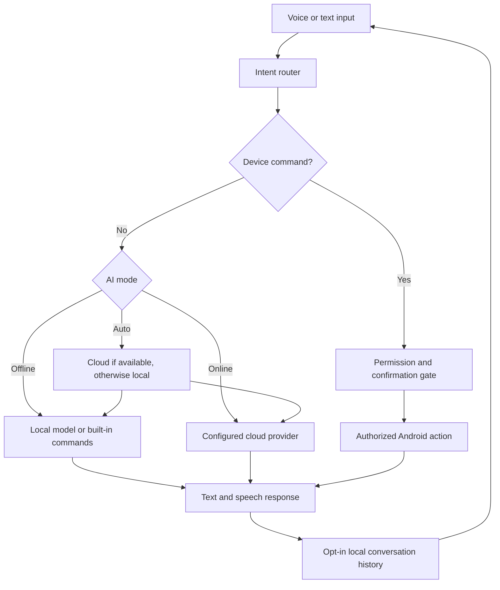

# AITRONICS architecture

Target architecture, not a claim of completed features.

## Implementation roadmap
1. Modern Compose UI, mode selection, speech and cloud client: implemented in source, verify build and device behavior.
2. Local inference runtime and downloadable compatible model; built-in commands remain available without model.
3. Room-backed opt-in history and memory with deletion controls.
4. User-enabled notification and accessibility services, explicit confirmation for sensitive actions.
5. WorkManager scheduling and supported wake-word service with visible controls.
6. Unit tests, lint, APK build and physical-device validation.

Cloud credentials must never be committed. Offline mode must not silently send conversation data to cloud. Android permissions and OS limitations apply. No claim of full offline generative AI until local inference is integrated and tested.
